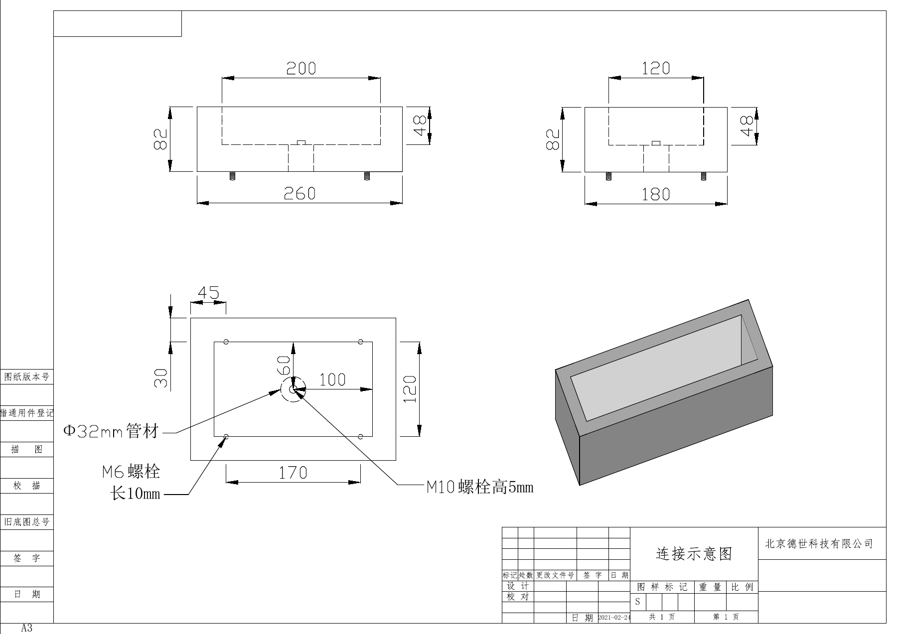

# LC cryo-MOST Component List and Technical Drawings

[中文说明](README.zh-CN.md)

This repository provides the component list and selected mechanical designs for line-confocal cryo-micro-optical sectioning tomography (LC cryo-MOST). The platform combines autofluorescence imaging with cryogenic milling for co-registered 3D visualization of soft and hard tissues in whole undecalcified mouse joints without chemical fixation or exogenous labeling.

The materials help other research groups identify the hardware used in the system, inspect the shared cryogenic designs, and discuss implementation or collaborative imaging with the authors.

## Available files

| File | Contents | Format |
| --- | --- | --- |
| [Parts List.xlsx](Parts%20List.xlsx) | Complete component list for the reported system: 31 numbered entries with component names, models, manufacturers, and countries. | Excel workbook |
| [Insulated box.pdf](Insulated%20box.pdf) | Dimensioned drawing and connection layout of the insulated box. | PDF |
| [LN2 tank.SLDPRT](LN2%20tank.SLDPRT) | SolidWorks part file for the liquid-nitrogen tank. | SolidWorks SLDPRT |
| [Component list for browser viewing](docs/parts-list.md) | Browser-readable transcription of the Excel component list. | Markdown |

The shared drawings cover selected cryogenic components. The optical configuration, acquisition parameters, and milling–imaging workflow are described in the Methods and Supplementary Fig. 1 of the associated manuscript.

## Viewing the materials

1. Download individual files using the links above, or select **Code → Download ZIP** to obtain the repository contents.
2. Open the component list in Excel or another application that supports XLSX files. The browser-readable list contains the same 31 entries.
3. Open the insulated-box drawing in a PDF viewer. Open the tank part file in SolidWorks or a compatible CAD viewer; compatibility depends on the application and file version.
4. Use the drawings and component list together with the manuscript when considering a system adapted to your hardware configuration. Contact the authors for technical questions about the custom components and system integration.

### Insulated box drawing

[Download the original PDF drawing](Insulated%20box.pdf).

## Control software

The custom control software coordinates device motion, image acquisition, and liquid-nitrogen management. It was developed for the existing hardware configuration and is closely coupled to specific device interfaces and control parameters. The source code has not yet been publicly released.

The manuscript describes the device configuration, key parameters, and operating workflow to guide implementation on other hardware platforms. Researchers interested in adapting these functions are welcome to contact the corresponding author for technical discussion.

## Access and collaboration

Other research groups are welcome to discuss collaborative use of the LC cryo-MOST platform. Please contact the corresponding author to discuss sample suitability, imaging requirements, technical implementation, and collaboration arrangements.

**Corresponding author:** Jing Yuan  
**Institution:** Huazhong University of Science and Technology  
**Email:** [yuanj@hust.edu.cn](mailto:yuanj@hust.edu.cn)

Technical questions about these files may also be raised through GitHub Issues.

## Associated study

These materials accompany the manuscript:

*Volumetric Autofluorescence Imaging of Soft and Hard Tissues in Whole Undecalcified Joints Using Line-confocal Cryo-Microscopic Optical Sectioning Tomography.*

Authors: Mingyu Tian, Haoyu Gong, Chuancao Sun, Huijuan Pan, Bolin Lu, Ting Zhu, Qingming Luo, and Jing Yuan.

Please cite the associated study when using these materials in research. Publication details and the DOI will be added when available.

## Maintainer

HUST Yuan Laboratory — [HUST-Yuan-Lab](https://github.com/HUST-Yuan-Lab)
